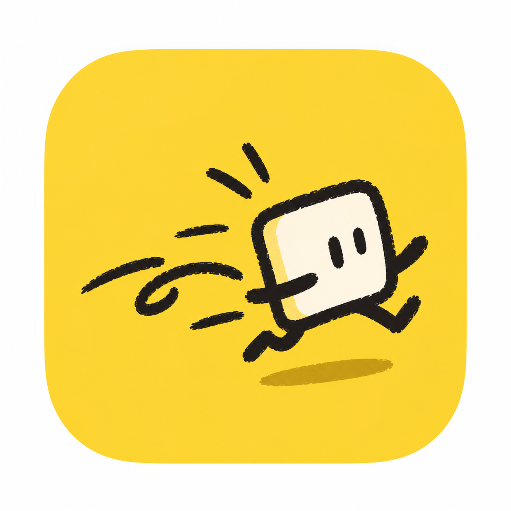

# Chuckaway

A native macOS application designed to thoroughly uninstall apps and eliminate all associated residues, including system library data (`~/Library`: Application Support, Caches, Preferences, Containers, Group Containers, Logs, Saved Application State, WebKit, HTTPStorages, LaunchAgents) and local dotfile/XDG directories (`~/.<app>`, `~/.config`, `~/.cache`, `~/.local/state`, `~/.local/share`).



## Key Features

- **Automatic Application Detection**: Scans installed applications across `/Applications`, `~/Applications`, and user directories.
- **Browse & Drag-and-Drop**: Inspect any `.app` bundle via file selection or direct drag-and-drop onto the window.
- **Deep Residue & Dotfile Detection**: Discovers associated remnants across `~/Library` and Home dotfile/XDG locations (including CLI tools and local AI model caches) using bundle identifiers and app tokens.
- **System App Protection**: Flags and locks macOS built-in system applications to prevent unintended removal.
- **Safe Trash Removal**: All removals route through macOS Trash (`FileManager.trashItem`), ensuring operations are fully recoverable.
- **High-Performance Native Engine**: Built entirely with Swift 6 and SwiftUI, leveraging parallel POSIX `fts` kernel directory traversal for instant sizing without heavy runtime overhead.

## Installation & Usage

### Prebuilt Release
Download the latest `Chuckaway.dmg` from the GitHub Releases page, open the disk image, and drag `Chuckaway.app` into your Applications folder.

To launch the packaged bundle directly:
```bash
open "dist/Chuckaway.app"
```

Or copy the app to `/Applications`:
```bash
cp -R "dist/Chuckaway.app" /Applications/
```

### Building from Source

#### Requirements
- macOS 14.0 or later (Sonoma, Sequoia)
- Xcode 16+ or Swift 6.0 toolchain

#### Development Run
```bash
swift run
```

#### Build Release App Bundle
```bash
./scripts/build_app.sh
```

The resulting application bundle will be created at `dist/Chuckaway.app`.
